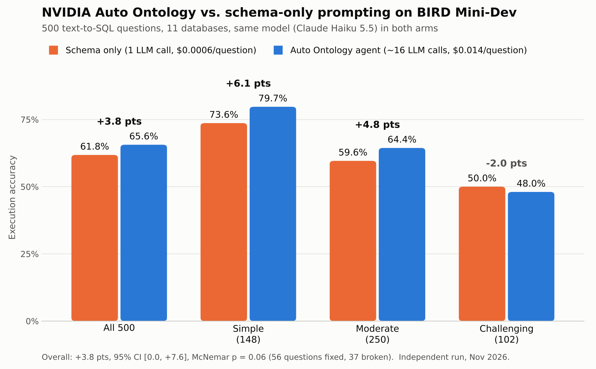

# Does an auto-generated semantic layer help text-to-SQL?

An independent benchmark of [NVIDIA Auto Ontology](https://github.com/NVIDIA/auto-ontology) on
[BIRD Mini-Dev](https://github.com/bird-bench/mini_dev): 500 questions across 11 databases, run with
NVIDIA's own evaluation harness, [auto-ontology-eval](https://github.com/NVIDIA/auto-ontology-eval),
and no changes to either codebase.



## Headline

With the same model (Claude Haiku 5.5) in both arms:

| | Schema only | Auto Ontology agent | Difference |
|---|---|---|---|
| **All 500** | 61.8% | **65.6%** | **+3.8 pts** (95% CI 0.0 to +7.6) |
| Simple (148) | 73.6% | 79.7% | +6.1 |
| Moderate (250) | 59.6% | 64.4% | +4.8 |
| Challenging (102) | 50.0% | 48.0% | −2.0 |

- **Paired outcome:** the ontology arm fixed 56 questions the baseline got wrong and broke 37 it got right. Exact McNemar test: **p = 0.06**, so the gain is promising but not significant at the 5% level.
- **Cost:** about 16 LLM calls and **$0.014 per question** for the agent, vs. 1 call and $0.0006 for the baseline, roughly 23× more. That's about **$0.36 per additional correct answer**.
- **Reliability:** 7 of 500 agent rollouts (1.4%) produced no SQL; the baseline produced SQL every time. Both are well under the harness's 5% validity threshold.

Accuracy is BIRD's execution accuracy: a prediction counts as correct when its result set equals the gold query's.

## What the two arms are

- **Control, schema-only (`schema_only_sql`):** one prompt with the database schema and BIRD's evidence hint; the model writes SQL directly.
- **Treatment, Auto Ontology (`auto_ontology_sql`):** Auto Ontology's LangGraph text-to-SQL agent, working over the semantic layer it compiled from the same databases (terms, descriptions, keys, join paths, embeddings).

Both arms run on NeMo Gym through the harness and see the same questions and evidence.

## Results by database

| Database | n | Schema only | Auto Ontology | Δ pts | Fixed / broken | McNemar p |
|---|---|---|---|---|---|---|
| card_games | 52 | 53.8% | 69.2% | +15.4 | 10 / 2 | 0.04 |
| debit_card_specializing | 30 | 66.7% | 80.0% | +13.3 | 4 / 0 | 0.12 |
| student_club | 48 | 72.9% | 83.3% | +10.4 | 7 / 2 | 0.18 |
| financial | 32 | 46.9% | 56.2% | +9.4 | 5 / 2 | 0.45 |
| formula_1 | 66 | 51.5% | 59.1% | +7.6 | 10 / 5 | 0.30 |
| thrombosis_prediction | 50 | 54.0% | 54.0% | +0.0 | 5 / 5 | 1.00 |
| california_schools | 30 | 46.7% | 46.7% | +0.0 | 4 / 4 | 1.00 |
| european_football_2 | 51 | 78.4% | 78.4% | +0.0 | 2 / 2 | 1.00 |
| superhero | 52 | 84.6% | 82.7% | −1.9 | 3 / 4 | 1.00 |
| toxicology | 40 | 55.0% | 52.5% | −2.5 | 2 / 3 | 1.00 |
| codebase_community | 49 | 61.2% | 53.1% | −8.2 | 4 / 8 | 0.39 |

The gain is concentrated in 5 databases; only card_games is individually significant. With 30–66 questions per database, per-database differences under about ±15 points are within noise.

## Caveats

- **One model.** Auto Ontology's maintainers test with Claude Opus. Haiku 5.5 sometimes answered in text where a structured tool call was expected. The agent retried, and when table-relevance selection still failed (about 300 times across the run) it fell back to embedding-similarity ranking. A stronger model may show a larger gain.
- **Embedding and reranker choice.** NVIDIA's hosted Nemotron embedder and reranker were unavailable or unreliable on the free tier, so local open models were used (below). Neither adds the `Query:`/`Passage:` prefixes Jina v4 was trained with, so retrieval quality is likely slightly below what each model can do.
- **No agent-without-ontology baseline.** The treatment differs from control in two ways, multi-step agent and semantic layer, so this run can't separate their contributions.
- **One split, one run.** BIRD Mini-Dev only, a single run per arm, LLM sampling at provider defaults.

## Setup

| Component | Choice | Why |
|---|---|---|
| Harness | NVIDIA/auto-ontology-eval @ `ec41b2c` | NVIDIA's own benchmark code, unmodified |
| Auto Ontology | NVIDIA/auto-ontology @ `dd78d06` (v1.1.0) | Pinned by the harness |
| LLM, both arms | Claude Haiku 5.5 via a local LiteLLM gateway | Same model in both arms; gateway exposes the OpenAI-compatible endpoint and model naming Auto Ontology expects |
| Embeddings | `jina-embeddings-v4` (Q8_0 GGUF) on llama.cpp | Auto Ontology's vector store is fixed at 2048 dimensions; this model outputs 2048 natively |
| Reranker | `bge-reranker-v2-m3` (Q8_0 GGUF) on llama.cpp | llama.cpp's `/v1/rerank` matches Auto Ontology's rerank request format |
| Catalog | Postgres + pgvector (Auto Ontology's docker-compose) | Fresh catalog for each build |

All configuration is through environment variables and external services. See [`config/env.example`](config/env.example), [`config/litellm.yaml`](config/litellm.yaml) and [`scripts/start_services.md`](scripts/start_services.md).

### Reproduce

1. Clone `NVIDIA/auto-ontology-eval`, follow its README to install, and download BIRD Mini-Dev (SQLite).
2. Start the services in [`scripts/start_services.md`](scripts/start_services.md) and run the smoke tests there.
3. Merge [`config/env.example`](config/env.example) into the harness's `.env`.
4. Run [`scripts/run_benchmark.sh`](scripts/run_benchmark.sh) from the harness root: build, smoke test, then 5 chunks of 100 questions. About 4 hours with 3 workers.
5. Analyse:
   ```bash
   python analysis/extract_summary.py          # inside runs/full_haiku, writes summary.json
   python analysis/analyze.py results/summary.json results/results.json
   python analysis/chart.py   results/results.json results/bird_auto_ontology_results.png
   ```

**Total API cost:** about $10, of which about $7.40 was the 500-question benchmark. The rest went on two ontology builds and smoke tests.

### Practical notes from getting it running

- The `nvapi-` defaults in this Auto Ontology version point at a chat model that was retired on 2026-09-01 (HTTP 410). Set the model explicitly.
- Names not starting with `openai/`, `azure/` or `aws/` go through `ChatNVIDIA`, which calls `/v1/models` and fails behind NeMo Gym's proxy. Use one of those prefixes.
- Embedding vectors must be exactly 2048-dimensional. Smaller models fail with `expected 2048 dimensions`.
- The reranker settings (`RERANK_*`) aren't in the harness's `.env.example`. Without them, reranking falls back to the chat endpoint and fails silently, picking the first candidate for bridge-table ownership.
- During semantic compile, `SEMANTIC_LLM_MAX_INFLIGHT` (default 6) replaces `LLM_MAX_INFLIGHT`, so set it too when rate-limited.
- `evaluation.json` is grouped by database, so `--limit N` doesn't give a representative sample. Use `--start-index/--end-index` chunks over the full set.
- Free inference tiers aren't enough: the agent arm alone uses about 40M tokens.

## Repository layout

```
results/summary.json       one row per question: db, difficulty, correctness per arm, tokens
results/results.json       aggregate statistics (overall, by difficulty, by database, cost)
results/*.png              chart
analysis/                  extraction, statistics (bootstrap CI, exact McNemar), chart
config/                    LiteLLM config and the .env settings used
scripts/                   service commands and the benchmark run script
```

## Credits and licences

- BIRD benchmark: Li et al., *Can LLM Already Serve as a Database Interface? A BIg Bench for Large-Scale Database Grounded Text-to-SQLs* (NeurIPS 2023). Question text in `results/summary.json` comes from BIRD Mini-Dev, under its CC BY-SA 4.0 licence.
- Auto Ontology and auto-ontology-eval: NVIDIA. This repository contains no NVIDIA code.
- Code in this repository: MIT licence.
